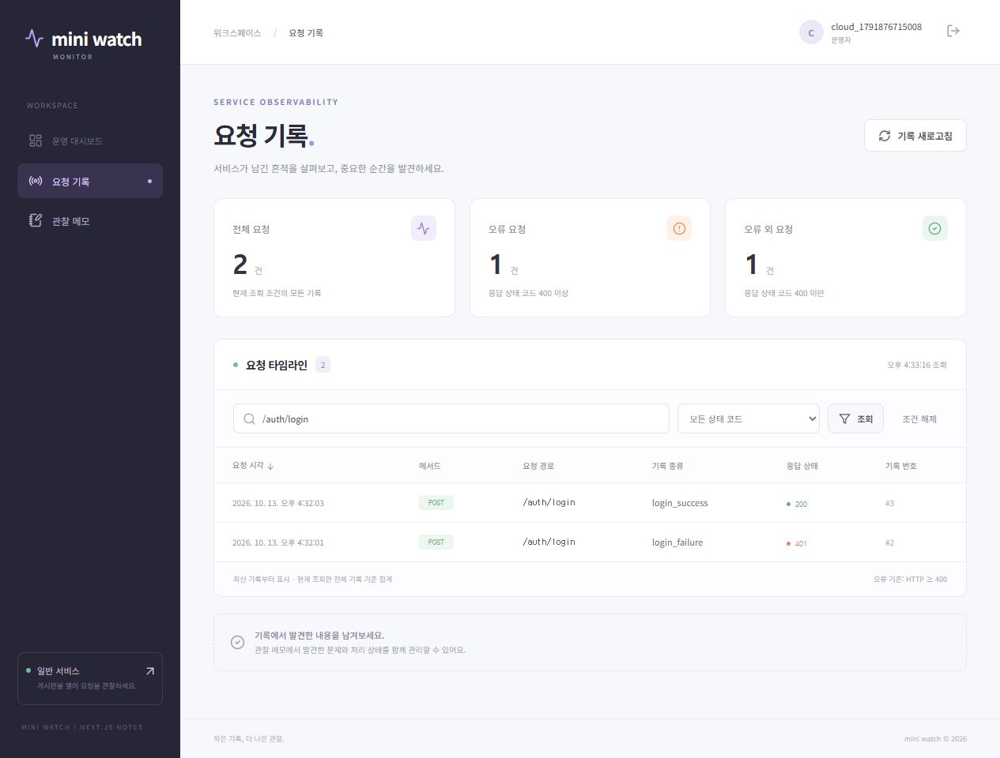

# 미니프로젝트에 클라우드 배포와 오류 수집 적용하기

[Codemit 54번 과제](https://classroom.codemit.kr/classes/5/problems/54/submit)의 **필수 20개·선택 4개**에 맞춰 기존 일반 게시판·감시 API·Next 대시보드를 확장했다.
항목별 코드 근거는 [CHECKLIST.md](CHECKLIST.md), 배포 설정·환경 변수·DB·진단·Sentry 변경 비교는 [deployment-plan.md](deployment-plan.md)에 정리했다.
Classroom 제출은 사용자가 직접 한다.

| 앱 | 역할 | 이번 직접 적용 |
| --- | --- | --- |
| general / Flask | 일반 로그인·게시글 CRUD·기록 전송 | Waitress/PORT·세션·health·DB SSL·이벤트 토큰·Sentry 및 실습 오류 수정 |
| monitor/backend / Flask | 감시 로그인·기록 분류·메모 CRUD | Waitress/PORT·DB SSL·users 이행·이벤트 토큰·세션/CSRF·Sentry |
| monitor/next-frontend / Next | 감시 화면·같은 사이트 API 프록시 | npm production build/start·요청 때 서버 API 주소·쿠키/CSRF/상태 전달·실패 재시도 |

시작 코드: [mini-watch-compose](https://github.com/RockCandy444/mini-watch-compose)의 `2e4b61d`.
공식 zeroskill2400/mini-watch day07-cloud-materials의 배포 지원 자료를 비교·적용했다.
기존 게시글·로그인·회원가입·기록·메모·화면 디자인과 두 Compose 및 gateway를 유지했다.
각 앱 이미지가 루트 밖 공통 파일에 의존하지 않도록 common/registration.py의 사본도 각 Flask 폴더에 포함했다.

**세 앱을 Render Free에 배포하고 서로 다른 Supabase 프로젝트에 연결했다.**
일반 게시판은 [일반 앱](https://rockcandy-mini-general.onrender.com), 기록·메모는 [감시 대시보드](https://rockcandy-mini-monitor-web.onrender.com)에서 사용할 수 있다.
화면의 회원가입으로 본인 계정을 만든다. 일반 계정과 감시 계정은 각각 준비한다.
실제 서비스·DB 권한·무료 설정은 [LIVE_DEPLOYMENT.md](LIVE_DEPLOYMENT.md), 원격 검증은 [public-results.md](verification/public-results.md)에 기록했다.
로그인·게시글·메모·실패/성공 기록의 실제 저장과 조회를 확인했다. Sentry SDK는 연결했지만 DSN과 대시보드 수신은 아직 설정하지 않았다.

## 로컬 실행

Docker Desktop Linux 엔진과 Compose를 준비하고 루트에서 실행한다. 공유 망이 있으면 network create만 생략한다.
Compose는 로컬 테스트 설정이며 실제 클라우드 비밀값을 포함하지 않는다.

```powershell
git clone https://github.com/RockCandy444/mini-watch-cloud.git
cd mini-watch-cloud
git switch day2-deploy
docker network create m5d1-events
docker compose -f compose-monitor.yaml config --quiet
docker compose -f compose-general.yaml config --quiet
docker compose -f compose-monitor.yaml up -d --build
docker compose -f compose-monitor.yaml exec monitor-api python create_user.py
docker compose -f compose-general.yaml up -d --build
docker compose -f compose-general.yaml exec general-api python create_user.py
```

interactive 계정 준비에서 본인 실습 아이디·비밀번호를 입력한다. 원격 계정은 배포 계획의 **각 앱 로컬 가상환경** 방법을 사용한다.
일반은 http://localhost:8081/login 및 게시판, 감시는 http://localhost:8082/ 및 /notes이다.
일반에서 실패·성공 로그인을 만든 뒤 감시에 로그인하여 기록을 새로고침한다.
게시글·메모를 저장·수정하고 화면을 새로고침해 DB에서 같은 자료를 읽는다.

감시 브라우저 → /api/... → Next 서버 → 감시 Flask → 감시 DB.
일반 Flask → /api/events + 서버 이벤트 토큰 → 감시 Flask → 감시 DB.
local HTTP의 secure는 false, Render HTTPS는 true이고 두 SECRET_KEY는 분리한다.
Compose는 로컬 DB·망·gateway용이며 Render에는 각 앱 Dockerfile과 외부 Supabase 설정을 사용한다.

```powershell
# named volume 보존: -v를 붙이지 않는다.
docker compose -f compose-general.yaml down
docker compose -f compose-monitor.yaml down
```

다시 up한 뒤 계정을 다시 만들지 않고 이전 계정·자료를 확인한다. /health 200과 실제 DB 기능 성공을 구분한다.

## 검증과 이번 커밋

2026-10-13 (Asia/Seoul)에 세 이미지를 빌드했다. 외부 API·DB 설정이 없는 Next production build도 성공했다.
일반 PostgreSQL 통합 테스트 13개·감시 통합/프록시/health 14개·Sentry 보호/정보 제외 2개가 통과했다.
[HTTP smoke](verification/cloud-smoke.cjs)는 두 DB의 게시글·메모 CRUD, 로그인 실패/성공 분류, 쿠키·CSRF,
일곱 컨테이너 재생성 후 자료·세션 유지, 감시 API 중지의 502와 복구 후 200을 확인했다.
[실제 결과 요약](verification/cloud-results.md)에는 확인 범위만 기록했다.

Node.js 22 이상에서 fixture 검증을 반복할 수 있다. 스크립트는 로컬 테스트 계정·게시글·메모를 만들고 테스트 게시글·메모를 정리한다.

```powershell
node verification/cloud-smoke.cjs
# 실제 배포: 독립 테스트 계정·자기 게시글/메모로 검증
node verification/public-smoke.cjs
# 임시 DB 스키마에서 기존 회귀 검증:
./verification/run-regressions.ps1
```

| 이번 커밋 | 내용 |
| --- | --- |
| 6d14279f1dc1135f9ccc3755328924159fd19e54 | 배포·외부 DB·세션·토큰·Sentry·Next 프록시 적용, guarded 실습 오류 재현 상태 |
| 979f7da856ff96183e86f0c012f2c3a73ce5bf41 | general sentry_test() 나눗셈 오류 수정, 보호·정보 제외 테스트 |
| 3ad433c228111a06f6718617e85311d340f3800d | 최종 DB 설정·회귀/HTTP/화면 검증·배포 계획·필수 20/선택 4 문서 |

최종 설정·검증·문서 커밋은 [GIT_WORK.md](GIT_WORK.md)에 기록한다.
오류 원인·수정 효과·보호 조건과 [실제 diff](verification/sentry-fix.diff), 잠시 true로 확인 후 false로 끄는 절차를 배포 계획에 포함했다.
Sentry는 개발·Waitress 실행에 모두 연결되며 Resolve가 코드 수정·재배포를 대신하지 않는다.
실제 .env·비밀번호·토큰·DSN·node_modules·.next·가상환경·DB 파일은 Git/Docker에 넣지 않는다.
기존 evidence/·과거 기능 가이드는 Day1 참고이며 로컬 결과는 verification/cloud-results.md, 실제 배포 결과는 verification/public-results.md가 기준이다.



제출 저장소: **https://github.com/RockCandy444/mini-watch-cloud**
