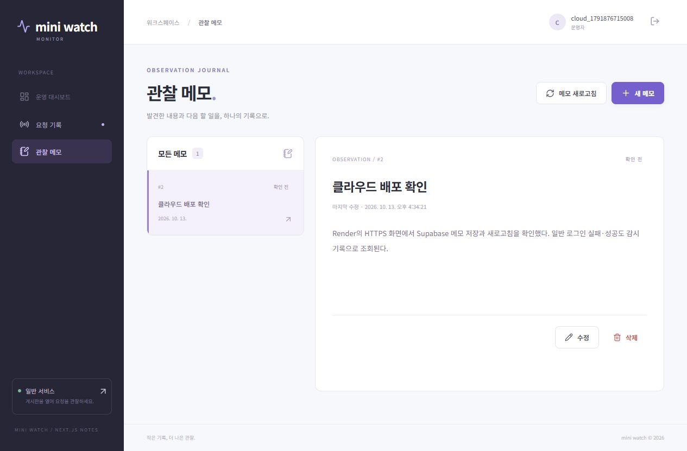

# 실제 클라우드 배포

서비스 설정 날짜: 2026-10-13, Asia/Seoul. 원격 기능 검증 결과는 [verification/public-results.md](verification/public-results.md)에 기록한다.
확인한 Live 코드: 일반·Next `54c587ddbe287c8ae248ae3212eeaebea7c0c9d0`, 감시 API `0a07c98d592f134f39de209a433dedecb2dd9de1`.

| 서비스 | 공개 주소 | Render 서비스 ID | Root Directory | Dockerfile / Context | Health |
| --- | --- | --- | --- | --- | --- |
| 일반 Flask | https://rockcandy-mini-general.onrender.com | srv-db6tko7f3r2c73cgdo30 | general | ./Dockerfile / . | /health |
| 감시 Flask | https://rockcandy-mini-monitor-api.onrender.com | srv-db6teel9fdbs73eaahdg | monitor/backend | ./Dockerfile / . | /health |
| 감시 Next | https://rockcandy-mini-monitor-web.onrender.com | srv-db6tiqek1f9s73bh9deg | monitor/next-frontend | ./Dockerfile / . | / |

사용자가 선택한 Render **My Workspace**, Singapore 지역, 세 서비스 모두 **Free ($0/month)** 컴퓨트이다.
별도의 유료 플랜·카드·도메인·디스크를 추가하지 않았다. GitHub 공개 저장소의 day2-deploy 브랜치를 사용한다.
공개 Git Repository 방식으로 생성했으므로 이번 실제 서비스는 **수동 배포**한다. 변경 push 후 Render에서 Manual Deploy → Deploy latest commit을 실행하고 SHA를 확인한다.
On Commit은 기존 배포 계획의 권장 설정이며, 공개 repo 연결에 대한 실제 수동 설정과 구분한다.
서버 환경 변수를 변경한 경우 Save, rebuild, and deploy를 사용한다.

## 외부 DB와 기존 자료 보존

사용자가 승인한 Supabase **RockCandy444's Org (Free)**를 사용했다.

| 앱 | 프로젝트 | Ref | Session pooler Host | DB User | Port / Name / SSL |
| --- | --- | --- | --- | --- | --- |
| 일반 | 기존 RockCandy444's Project, Mumbai | buddejtjdpwxgthvfpnu | aws-0-ap-south-1.pooler.supabase.com | mini_general_app.buddejtjdpwxgthvfpnu | 5432 / postgres / require |
| 감시 | 새 mini-watch-monitor, Seoul | nbclbczasgfqbeeqhtnf | aws-0-ap-northeast-2.pooler.supabase.com | mini_monitor_app.nbclbczasgfqbeeqhtnf | 5432 / postgres / require |

각 deploy.sql을 실행했다. 일반에 users/posts를 추가하고 기존 notes **10개**는 보존했다.
일반 전용 DB LOGIN 계정은 새 users/posts와 그 시퀀스에만 권한을 부여했다. 기존 notes SELECT 권한은 **false**임을 SQL로 확인했다.
감시 전용 계정은 users/http_events/notes와 해당 시퀀스에만 권한을 부여했다. 관리자 비밀번호를 변경하지 않았다.
권한 설정의 비밀값 없는 예시는 각 앱의 sql/server-access.example.sql이다.
이 배포에서 새 테이블은 RLS를 켜고 해당 서버 DB 계정에만 정책을 부여했다. 정책이 없는 anon/authenticated에 앱 테이블을 공개하지 않는다.
기존 일반 프로젝트의 Data API와 기존 notes 정책을 바꾸지 않아 과거 앱 기능을 보존했다. 새 감시 프로젝트는 생성 시 Data API를 껐다.
DB 비밀번호·서명 키·이벤트 토큰은 실제 Render 서버 설정에 있으며 GitHub나 화면 증거에 포함하지 않는다.

## 연결과 화면 사용

감시 Next의 MONITOR_API_URL은 위 감시 Flask 기준 URL이다.
일반 MONITOR_URL은 감시 Flask 기준 URL + /api/events이며 두 Flask의 EVENT_TOKEN을 같게 설정했다.
감시 GENERAL_API_URL은 일반 기준 URL이다. 두 앱 FRONTEND_ORIGIN은 감시 Next의 HTTPS origin이다.
각 SECRET_KEY를 분리하고 SESSION_COOKIE_SECURE=true로 HTTPS 쿠키를 사용한다.
Next Dockerfile은 NEXT_PUBLIC_GENERAL_URL을 ARG로 받아 공개 게시판 링크만 빌드에 포함한다.

감시 화면의 **회원가입**으로 본인 감시 계정을 만들고 로그인한다. 같은 화면의 **일반 게시판 계정은 여기서 만들기** 링크로 일반 계정을 준비한다.
일반의 /login에서 일반 계정으로 로그인한 후 게시글을 작성·수정·삭제한다. 공개 읽기는 가능하며 변경은 로그인과 CSRF가 필요하다.
원래 create_user.py를 각 앱의 로컬 가상환경에서 사용해 계정을 준비하는 방법도 유지한다.
verification/public-smoke.cjs는 실제 배포를 검증하는 독립적인 테스트 계정을 만든다. 실제 사용자 비밀번호를 사용하거나 보고서에 출력하지 않는다.

## 운영 범위

Flask 두 앱은 Waitress app:app, Next는 production build/start로 실행한다.
ENABLE_SENTRY_TEST=false를 유지해 실습 경로는 404다. Sentry SDK는 코드에 연결되어 있으나 실제 DSN은 아직 설정하지 않아 Sentry 수신을 확인하지 않았다.
무료 Render는 유휴 상태에서 잠들 수 있으므로 첫 접속이 늦어질 수 있다. 무료 instance hours는 워크스페이스 전체에서 공유한다.
실제 유휴 후 접속에서 Render 기동 대기 화면을 확인했다. 감시 화면에 서버 연결 안내가 나오면 약 1분 기다린 뒤 **연결 다시 확인**을 누른다.
Supabase Free도 장기간 저활동 시 프로젝트가 일시 중지될 수 있다. 무료 서비스를 유료로 자동 전환하지 않았다.

참고: [Render 무료 서비스](https://render.com/docs/free), [Supabase Session pooler](https://supabase.com/docs/guides/database/connecting-to-postgres),
[Supabase 사용자 역할 연결](https://supabase.com/docs/guides/troubleshooting/tenant-or-user-not-found).

