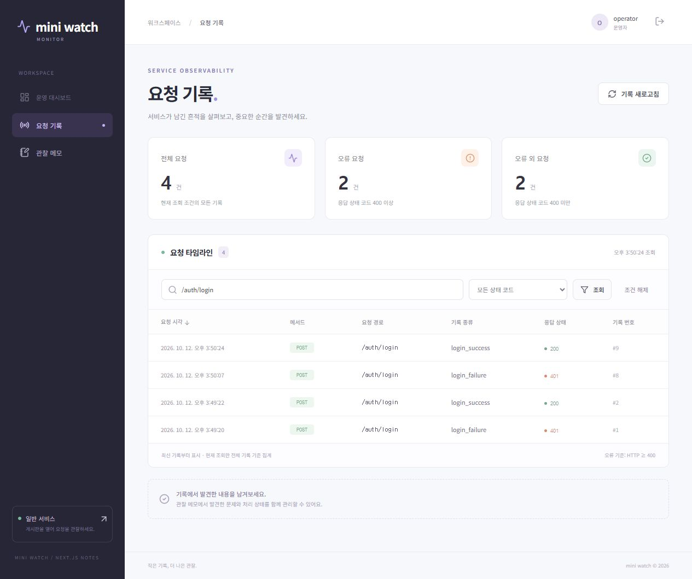
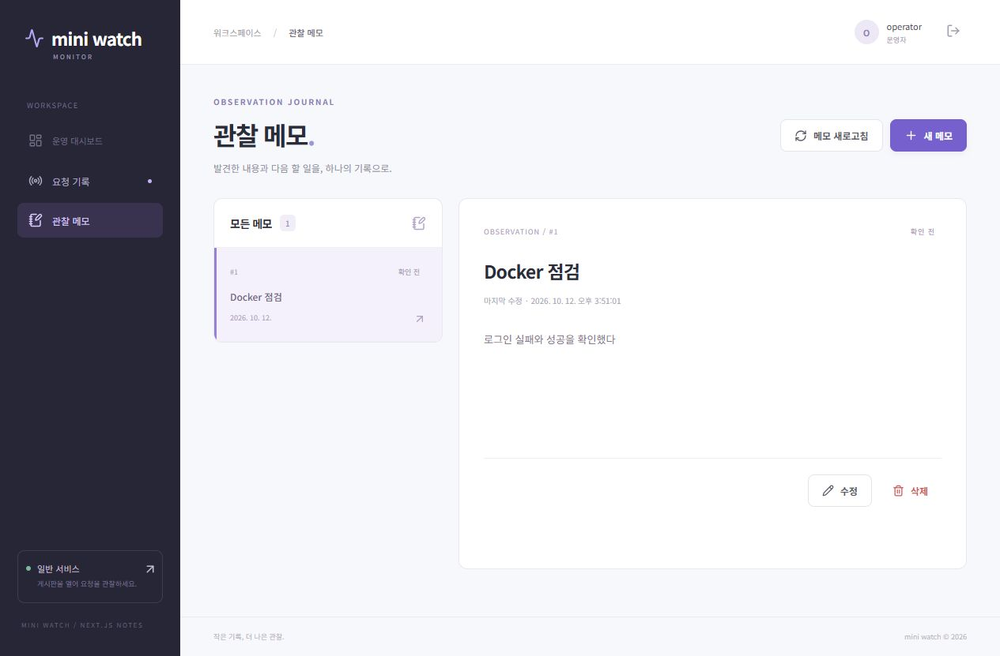

# 미니프로젝트를 두 Compose로 실행하기

[Codemit 과제 51](https://classroom.codemit.kr/classes/5/problems/51/submit)의 일반 게시판과 감시 대시보드를 **서로 독립적인 두 Compose 프로젝트**로 실행합니다.
로그인 실패·성공 기록은 공유 망을 통해 감시 PostgreSQL에 저장하고, 관찰 메모는 화면에서 작성·새로고침합니다.
이번 실행에서 얻은 로그·화면은 [evidence](evidence)에 포함합니다. 강의실 제출은 사용자가 직접 진행합니다.
**필수 20개·선택 4개 확인 완료:** 항목별 근거는 [CHECKLIST.md](CHECKLIST.md), PR과 Git 커밋은 [GIT_WORK.md](GIT_WORK.md)에 정리했습니다.

## 시작 자료와 변경

- 수업 원본: [zeroskill2400/mini-watch](https://github.com/zeroskill2400/mini-watch).
- 이어 사용한 프로젝트: [next-notes-collaboration](https://github.com/RockCandy444/next-notes-collaboration)의 `10eb5572eaa5469b36920acfb2f49832019848c2`, 그 안의 `mini-watch` 게시판·감시 API·Next.js 화면.
- 두 Compose, Flask Dockerfile 2개, Next.js 다단계 Dockerfile, 빌드 제외 설정, Nginx 설정을 직접 추가했습니다.
- 두 DB의 기존 SQL을 초기화 디렉터리에 연결하고 named volume으로 데이터를 보존합니다.
- `create_user.py --classroom`은 실습 계정을 반복해서 준비하며 기존 계정을 덮어쓰지 않습니다.
- 화면의 기존 5100·5173 주소를 gateway 8081·8082로 바꾸고, 기록 표에 `event_type`을 표시했습니다.
- 기존 일반 회원가입 화면도 유지했습니다. 감시 gateway → 감시 API의 **단일 회원가입 경로** → 공유 망의 일반 API로 전달합니다. DB나 gateway가 공유 망에 들어갈 필요가 없습니다.
- `monitor/next-frontend`라는 기존 폴더명을 유지합니다. Compose 서비스 이름은 과제의 `monitor-web`입니다.
- 과거 `CRUD_GUIDE.md`, `DASHBOARD_GUIDE.md`, `SIGNUP_GUIDE.md`는 이전 로컬 실행 작업의 참고 자료입니다. **이번 Docker 실행은 이 README를 따릅니다.**

## 처음 실행하기

Docker Desktop의 Linux 엔진과 Docker Compose, Git을 준비합니다. 호스트에 Python·Node·PostgreSQL을 설치하지 않아도 앱이 실행됩니다.
아래 명령은 저장소 루트의 PowerShell에서 실행합니다. 8081·8082 포트를 비워 두세요.

```powershell
git clone https://github.com/RockCandy444/mini-watch-compose.git
cd mini-watch-compose
docker network create m5d1-events
docker compose -f compose-general.yaml config --quiet
docker compose -f compose-monitor.yaml config --quiet
docker compose -f compose-monitor.yaml up -d --build
docker compose -f compose-monitor.yaml exec monitor-api python create_user.py --classroom
```

공유 망이 이미 있다면 생성 명령만 생략합니다. `config --quiet`의 정상 결과는 출력 없이 종료 코드 0입니다.
감시 계정을 준비한 다음 로그인하여 **일반 프로젝트를 켜기 전에 `/api/auth/me` 200**을 확인합니다.
이 기존 앱은 비로그인 `/api/auth/me`를 401로 보호하므로 로그인 쿠키를 함께 보냅니다.

```powershell
$login = '{"username":"operator","password":"Learn123!"}'
Invoke-RestMethod http://localhost:8082/api/auth/login -Method Post -ContentType application/json -Body $login -SessionVariable monitorSession
Invoke-WebRequest http://localhost:8082/api/auth/me -WebSession $monitorSession | Select-Object StatusCode
docker compose -f compose-general.yaml up -d --build
docker compose -f compose-general.yaml exec general-api python create_user.py --classroom
docker compose -f compose-monitor.yaml ps
docker compose -f compose-general.yaml ps
docker compose -f compose-monitor.yaml logs --tail=30 monitor-api
docker compose -f compose-general.yaml logs --tail=30 general-api
docker network inspect m5d1-events
docker compose -f compose-general.yaml exec general-api getent hosts monitor-api
```

| 주소 | 계정 / 비밀번호 | 용도 |
| --- | --- | --- |
| http://localhost:8081/login | student / Learn123! | 일반 로그인 실패·성공 |
| http://localhost:8081/ | 로그인 결과 확인 후 이동 | 기존 게시글 목록·CRUD |
| http://localhost:8082/ | operator / Learn123! | 감시 로그인·실제 기록 조회 |
| http://localhost:8082/notes | 같은 감시 계정 | 관찰 메모 |
| http://localhost:8082/register | 새 감시 계정 | 기존 회원가입 |
| http://localhost:8082/register/general | 새 일반 계정 | 기존 일반 회원가입 |

Compose에는 **수업용 DB 비밀번호와 세션 키만** 명시했습니다. 별도 `.env` 복사가 필요하지 않습니다.
각 API의 `.env.example`은 기존 로컬 실행용 참고 예시이며 실제 `.env`는 이미지·Git에 넣지 않습니다.
Flask는 Dockerfile의 명령으로 `0.0.0.0:5000`에서 실행합니다. Next.js는 이미지 빌드 중 `npm ci`와 `npm run build`를 수행하고,
실행 이미지에서 standalone `node server.js`를 `0.0.0.0:3000`으로 실행합니다.
일반 이미지에는 기존 일반 통합 테스트가 사용하는 감시 Python 모듈도 포함하지만 **실행되는 앱은 일반 API 하나**입니다.
두 Python 이미지의 빌드 context는 공통 등록 코드를 포함하기 위해 루트이며 루트 `.dockerignore`가 실제 제외 설정입니다.
Next.js context는 `monitor/next-frontend`이고 해당 폴더의 `.dockerignore`가 적용됩니다.

## 네트워크와 공개 포트

| 서비스 | 화면 망 | DB 망 | 공유 망 `m5d1-events` | PC 공개 포트 |
| --- | --- | --- | --- | --- |
| general-gateway | general-web | — | — | 127.0.0.1:8081 → 80 |
| general-api | general-web | general-data | 참여 | 없음, 내부 5000 |
| general-db | — | general-data | — | 없음, 내부 5432 |
| monitor-gateway | monitor-web | — | — | 127.0.0.1:8082 → 80 |
| monitor-web | monitor-web | — | — | 없음, 내부 3000 |
| monitor-api | monitor-web | monitor-data | 참여 | 없음, 내부 5000 |
| monitor-db | — | monitor-data | — | 없음, 내부 5432 |

실제 프로젝트 이름은 `m5d1-general`과 `m5d1-monitor`입니다. 내부 망 이름에는 프로젝트 접두사가 붙습니다.
DB 망은 `internal: true`이며 DB는 자기 API와만 같은 망을 사용합니다.
두 Compose에 `events`라는 같은 키만 선언하면 서로 다른 `m5d1-general_events`·`m5d1-monitor_events`가 생깁니다.
여기서는 **둘 다 `external: true`, `name: m5d1-events`**로 미리 만든 동일한 실제 망을 참조하고, 두 API의 `networks`에도 참여를 지정했습니다.
이는 [Docker의 외부 망 연결 설명](https://docs.docker.com/compose/how-tos/networking/)과 같은 방식입니다.

일반 DB는 `general-db:5432 / general_db / general`, 감시 DB는 `monitor-db:5432 / monitor_db / monitor`로 접속합니다.
일반의 `MONITOR_URL`은 `http://monitor-api:5000/api/events`입니다. 컨테이너에서 상대 앱을 `localhost`나 PC 공개 포트로 찾지 않습니다.
각 DB의 `pg_isready` healthcheck와 API의 `depends_on: service_healthy`로 자기 DB 준비를 기다립니다.
다른 Compose의 서비스를 `depends_on`으로 지정하지 않고 감시 로그인 응답을 직접 확인한 뒤 일반의 실험을 시작합니다.
최종 PR에서는 감시 API가 `/health`에서 실제 `SELECT 1`에 성공한 뒤에만 healthy가 되게 하고, 감시 화면·gateway가 이 준비 상태도 기다리게 개선했습니다.
[Docker의 시작 순서 설명](https://docs.docker.com/compose/how-tos/startup-order/)도 같은 준비 대기 동작을 설명합니다.

## 화면·DB 확인과 종료

1. 일반 로그인 화면에서 `student`와 잘못된 비밀번호를 입력하고 실패를 확인합니다. `Learn123!`로 다시 로그인하여 게시판 링크를 엽니다.
2. 감시 화면에 `operator`로 로그인합니다. 기록을 새로고침하거나 `/auth/login` 경로로 검색하여 `login_failure / 401`, `login_success / 200`을 확인합니다.
3. 관찰 메모에서 **제목 `Docker 점검`**, **내용 `로그인 실패와 성공을 확인했다`**를 저장합니다. 브라우저 새로고침 후 메모를 선택해 같은 내용을 다시 확인합니다.
4. 아래 두 `down`을 각각 실행합니다. **`-v`를 붙이지 않습니다.** 외부 공유 망과 DB named volume은 유지됩니다.

```powershell
docker compose -f compose-general.yaml down
docker compose -f compose-monitor.yaml down
docker compose -f compose-monitor.yaml up -d
# 위의 operator 로그인·/api/auth/me 200 확인을 다시 실행
docker compose -f compose-general.yaml up -d
```

기존 계정으로 다시 로그인해 이전 기록과 메모를 확인합니다. 계정 생성·초기 SQL 재실행은 필요하지 않습니다.
초기 SQL은 새 빈 볼륨의 첫 DB 시작에만 실행되며, 컨테이너를 제거해도 named volume의 DB는 남습니다.
감시가 꺼진 동안 일반에서 발생한 기록은 재전송되지 않습니다. 연결 복구 후 **새 실패·성공 로그인**을 만들어 확인하세요.

## 실제 실행 증거

검증 날짜: **2026-10-12, Asia/Seoul**. Docker Desktop 4.91.0, Engine 29.8.0, Compose v5.5.1, 컨테이너의 PostgreSQL 16·Python 3.12·Node 22·Next.js 16.4.0.

| 검증 | 실제 결과 및 증거 |
| --- | --- |
| 최초 빌드·설정·ps·logs·inspect·이름 조회 | [initial.txt](evidence/initial.txt): 각 config 0, DB healthy, 7개 서비스 Up, 공유 망에는 두 API만 존재, monitor-api 조회 `172.21.0.2`, 실제 로그인 실패·성공 수집 |
| 일반 로그인 후 게시판 | [일반 로그인](evidence/general-login.jpg), [게시판 화면](evidence/general-board.jpg) |
| 화면에서 기록 종류·코드 | [login-events.jpg](evidence/login-events.jpg): 이번 화면 로그인 #8 실패 401·#9 성공 200 |
| 메모 저장·새로고침 | [note-refreshed.jpg](evidence/note-refreshed.jpg): 메모 #1 제목·내용 재조회 |
| 두 Compose 종료·재실행 | [recreate.txt](evidence/recreate.txt), [before-recreate.json](evidence/before-recreate.json): 기존 기록 11개와 메모 전체 내용이 재생성 전후 정확히 동일, 컨테이너 ID는 변경 |
| 재생성 후 화면 메모 | [note-after-recreate.jpg](evidence/note-after-recreate.jpg) |
| 공유 망 분리·복구, DB 격리 | [network.txt](evidence/network.txt), 아래 선택 실험 설명 |
| restart·rebuild | [rebuild.txt](evidence/rebuild.txt), 아래 비교 설명 |
| 개선 PR 및 최종 통합 테스트 | [PR #1](https://github.com/RockCandy444/mini-watch-compose/pull/1), [final.txt](evidence/final.txt): 감시 14개·일반 12개 **총 26개 통과** |
| main 병합 후 실행 재확인 | [postmerge.txt](evidence/postmerge.txt): 새 실패·성공 기록 전달, 기존 메모 상세·DB 준비 응답·망·설정·실행 상태 확인 |
| 병합 후 화면 | [events-after-merge.jpg](evidence/events-after-merge.jpg)의 #27 실패·#28 성공, [note-after-merge.jpg](evidence/note-after-merge.jpg)의 동일 메모 #1 |

명령 원문과 필요한 응답을 로그에 함께 저장했습니다. `getent` 성공은 Docker DNS와 같은 망 참여의 확인입니다.
HTTP 200·201 및 화면 기록은 앱의 실제 응답·전달 확인이며, DB 재생성 전후 동일 자료 비교는 저장 지속성 확인입니다.
이 세 확인 범위를 구분합니다. 예시 출력은 실제 실행 결과에 포함하지 않았습니다.




## 선택 실험

**공유 망 분리·복구:** 일반 API를 `docker network disconnect m5d1-events <일반API ID>`로 잠시 분리했습니다.
`getent hosts monitor-api`는 출력 없이 종료 코드 2가 되었고 일반의 실패·성공 로그인과 게시판 200은 동작했지만 감시 기록은 **14개 그대로**였습니다.
일반 API 로그의 전송 실패 경고도 확인했습니다. 원래 Compose로 API와 gateway를 `up -d --force-recreate`한 뒤 이름 조회가 복구됐고,
새 실패·성공과 게시판 요청이 #15~17로 수집돼 **17개**가 됐습니다. 분리 중 실패한 전송은 나중에 다시 나타나지 않았습니다.
gateway도 재생성해 Nginx가 이전 API IP를 계속 사용하지 않게 했습니다.

**restart와 rebuild:** 호스트의 `general/routes/auth.py` 로그인 응답을 `로그인 성공`에서 `로그인 성공 · Docker 실행`으로 변경했습니다.
`docker compose -f compose-general.yaml restart general-api` 후에는 이전 문구가 반환되고 이미지·컨테이너 ID도 동일했습니다.
`up -d --build general-api`와 gateway 재생성 후에는 새 문구가 반환되고 이미지·컨테이너 ID가 모두 변경됐습니다.
소스는 PC 파일, 이미지는 Dockerfile의 COPY 시점에 포함한 소스와 의존성, 컨테이너는 그 이미지로 실행한 프로세스입니다.
소스를 볼륨으로 연결하지 않았으므로 restart는 PC의 바뀐 소스를 읽지 않습니다. 최종 소스에는 새 문구를 유지합니다.

**DB 망 분리:** 일반 API의 `getent hosts general-db`는 `172.24.0.2`를 반환하고,
`getent hosts monitor-db`는 출력 없이 종료 코드 2입니다. 일반 API와 자기 DB는 `general-data`를 공유하지만 감시 DB는 `monitor-data`에만 있기 때문입니다.
이는 이름 조회 범위의 결과이며 DB 비밀번호 인증이나 SQL 성공의 증명은 아닙니다. 일반의 실제 로그인·게시판 응답과 메모 SQL 저장은 별도로 검증했습니다.

**PR 개선:** 감시 API의 실제 DB 준비 상태를 healthcheck로 확인하고 화면·gateway가 API 준비를 기다리는 개선을 `codex/monitor-readiness`에서 커밋하고 [PR #1](https://github.com/RockCandy444/mini-watch-compose/pull/1)의 diff를 검토해 merge commit으로 병합했습니다.
변경 파일·검토 의견·커밋 식별자와 병합 후 실행 결과는 [GIT_WORK.md](GIT_WORK.md)에 기록했습니다.

## 검증 재현

Python 3.11 이상이 있는 호스트에서는 표준 라이브러리만 사용하는 검증 도구도 실행할 수 있습니다.
`initial`은 앱을 빌드·실행하고 실습 계정을 준비합니다. 화면에서 메모를 저장한 뒤 `recreate`를 실행합니다.
`network`는 과제 API를 잠시 공유 망에서 분리하고 finally에서 Compose 설정으로 복구합니다.
`rebuild`는 **원래 문구인 커밋 `95bf251` 상태**에서 실행하는 소스 변경 실험입니다. 현재 소스에서 또 실행하려면 원래 문구로 되돌려 먼저 이미지를 빌드해야 합니다.

```powershell
python verification/run.py initial
# 화면에서 위의 Docker 점검 메모를 저장
python verification/run.py recreate
python verification/run.py network
python verification/run.py rebuild
python verification/run.py final
python verification/run.py postmerge
```

`final`은 각 컨테이너에서 기존 PostgreSQL 통합 테스트와 회원가입 프록시 테스트를 실행합니다.
테스트는 임시 스키마만 사용·정리하고 실습 계정·게시글·기록·메모를 수정하지 않습니다.

## Git 기록과 제출

- Docker 적용 최초 커밋: `95bf25128cfe80248da14a4cc8b0575c07c52ba9` — 두 Compose·세 Dockerfile·Nginx·망 분리·실행 증거.
- 이후 비교 실험·PR·최종 재검증 커밋은 [GIT_WORK.md](GIT_WORK.md)에서 확인합니다.
- 소스, Compose, Dockerfile·`.dockerignore`, Python 패키지 목록, npm 잠금 파일, 초기 SQL, gateway 설정, README와 실제 실행 증거를 함께 제공합니다.
- 실제 `.env`·토큰·가상환경·node_modules·.next·캐시·DB 파일은 제출하지 않습니다.

제출 주소: **https://github.com/RockCandy444/mini-watch-compose**
